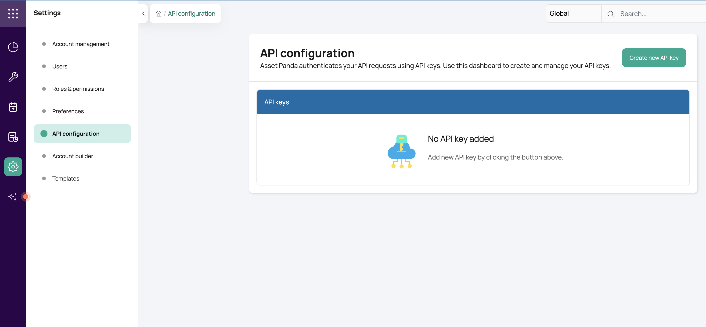

# __Description__

  Connector for Asset Panda.

# __Overview__

  Asset Panda is a cloud-based IT Asset Management (ITAM) and asset tracking platform that helps organizations manage
  hardware, software, and physical inventory throughout their entire lifecycle.

  This connector imports Assets, People, Locations, Accounts, and Modules from the Asset Panda REST API into the
  Rapid7 Platform.
  Because Asset Panda is fully schema-flexible, the collections that map to each type and the custom fields
  that populate key properties are all configurable in Settings.

# __Documentation__

  ## __Setup__

  The connector requires the following settings to connect and import data from Asset Panda.

  ### Generate API Credentials

  1. Log in to your Asset Panda account at [https://app.assetpanda.app](https://app.assetpanda.app).
  2. Navigate to **Settings** (gear icon).
  3. Select **API configuration** and click **Create new API key**.

  

  4. Copy the **Access Key ID** and **Access Key Secret** — the secret is only shown once.

  > **Note:** Keep the Access Key Secret in a safe place. If it is lost, you must generate a new key.

  ### Required Permissions

  An Asset Panda API key inherits the permissions of the user and role that created it. The connector
  makes read-only calls to the `/accounts`, `/modules`, `/collections`, `/collection-columns`, and
  `/collection-records/search` endpoints, so the associated role must have at least **read (view)**
  access to:

  - **Accounts and Modules** — account and module configuration metadata.
  - **Collections and their fields** — the collection definitions and custom field (column) layouts.
  - **Records** — the entities in every collection you configure as Assets, People, or Locations.

  A user whose role lacks any of these can create the API key successfully but will see failures when
  testing the connector or during import. For the exact role/permission configuration, see the
  [Asset Panda API documentation](https://docs.api.assetpanda.app/docs) or contact your Asset Panda administrator.

  ## __Settings Configuration__

  After entering your API credentials, configure the remaining settings to tell the connector which
  collections to import and how to map your Asset Panda custom fields to Surface Command properties.

  ### Collection Settings

  Asset Panda is fully schema-flexible; you control which collections are treated as Assets, People,
  and Locations.

  > **How to find the collection names:** In Asset Panda, the collections in your account (for example
  > *Assets*, *People*, *Location*) are listed in the left-hand navigation. Enter the names exactly as
  > shown, separated by commas when you want to import more than one collection as the same type.
  > Names are **case-insensitive**. A collection can only be configured as one type.
  > If a configured collection is renamed, deleted, or no longer visible to the API key, the
  > import fails rather than skipping it, so previously imported records are not removed.

  When several People (or Location) collections are configured, Asset Panda record numbers can
  repeat across them. A reference (such as *Assigned To*) to a record number that exists in more
  than one of those collections is ambiguous and is left empty, with a warning in the logs.

  ### Field Name Settings

  These settings map Surface Command properties to the **display name of a custom field as it
  appears in your Asset Panda collection** — not the actual field value.

  > **How to find the display name:** In Asset Panda, open any record in the target collection.
  > The label shown next to each field (e.g. *"Hostname"*, *"Work Email"*, *"Serial Number"*) is
  > the display name you should enter here. It is **case-insensitive**, so `hostname`,
  > `Hostname`, and `HOSTNAME` all match the same field.

  Three of these mappings are **required**, because Surface Command uses them to correlate
  records:

  - **Asset Hostname Field** — the Assets field that holds the machine hostname.
  - **People Email Field** — the People field that holds the person's email address.
  - **Location Name Field** — the Locations field that holds the location name.

  All other field mappings are optional — leave a setting blank to skip that property. Each
  setting's description in the connector configuration explains exactly what it maps. Use the
  connector's **Test** action to confirm the configured collection and field names are found.

  ### Additional Fields

  All other custom fields on a record are imported as-is under **Custom Fields**. Where your
  collections use the following field labels, they are also mapped to the matching Surface Command
  properties:

  - **Assets** — *Asset Tag*.
  - **People** — *Full Name*, *First Name*, *Last Name*, *Employee ID*, *Mobile Phone*, *Job Title*,
    *Department*.
  - **Locations** — *Address*, *City*, *State*.

  ### Example

  Suppose your Asset Panda **Assets** collection has a custom field labelled **"Computer Name"**
  that stores the machine hostname. You would enter `Computer Name` (not an actual hostname like
  `web-server-01`) in the **Asset Hostname Field** setting. The connector then reads every asset
  record, finds the field whose display name matches `Computer Name`, and maps its value to the
  `hostname` property in Surface Command.
