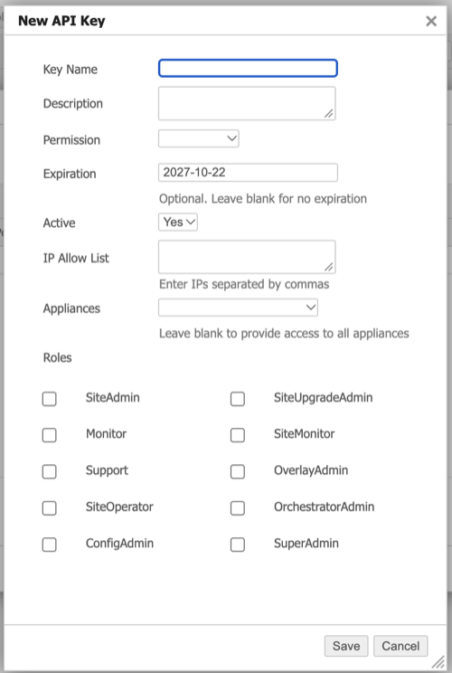

# __Description__

  Imports EdgeConnect SD-WAN appliances, appliance groups and users from HPE Aruba Networking Orchestrator.

# __Overview__

  HPE Aruba Networking EdgeConnect SD-WAN is a software-defined WAN and edge security platform, centrally managed by HPE Aruba Networking Orchestrator.

  This connector imports the EdgeConnect appliances managed by HPE Aruba Orchestrator (with their zone-based firewall policy status), the appliance groups they belong to, and the HPE Aruba Orchestrator user accounts.

# __Documentation__

  ## __Setup__

  The connector reads data from the HPE Aruba Networking Orchestrator REST API. It connects only to HPE Aruba Orchestrator, not to individual EdgeConnect appliances, and makes read-only requests.

  It requires HPE Aruba Networking Orchestrator 9.3 or later.

  > HPE Aruba Networking Orchestrator (formerly Silver Peak Orchestrator) is the management platform for EdgeConnect. It is a different product from the Rapid7 Orchestrator, which is only needed when HPE Aruba Orchestrator cannot be reached from the internet.

  ### Network Access

  Surface Command must be able to reach HPE Aruba Orchestrator over HTTPS. How you set this up depends on where HPE Aruba Orchestrator is hosted:

  * **Hosted by HPE (Orchestrator-as-a-Service), or reachable from the internet:** the connector runs in Surface Command. If a firewall or the API key's IP allow list restricts access, allow the Surface Command IP addresses: [Allowlist Surface Command IPs](https://docs.rapid7.com/surface-command/allowlist-surface-command-ips/).
  * **On your own network (on-premises or in a private cloud):** run the connector on a Rapid7 Orchestrator that can reach HPE Aruba Orchestrator. Surface Command shows the Rapid7 Orchestrator setup steps when you configure the connector. If the API key has an IP allow list, add the IP address of the Rapid7 Orchestrator.

  ### Orchestrator URL

  Use the address you open in a browser to sign in to HPE Aruba Orchestrator, for example `https://orchestrator.example.com`. Include the port if it is not 443, for example `https://orchestrator.example.com:8443`.

  You can also paste the API base URL from the HPE Aruba Networking documentation, which ends in `/gms/rest/`. The connector accepts the URL with or without that path.

  ### API Key

  1. Sign in to HPE Aruba Orchestrator as an administrator.
  2. Open the **Orchestrator** tab.
  3. Under **Users & Authentication**, select **API Keys**.
  4. Click **Add**. In the **New API Key** dialog:
     * Enter a **Key Name** and **Description**, for example `Rapid7 Surface Command`.
     * Set **Permission** to **Read-Only**. The connector only reads data.
     * **Expiration** may be filled in with a default date. Clear it for a key that does not expire, or keep the date and replace the key before it expires. The import fails once the key has expired.
     * Leave **Active** set to **Yes**.
     * Optionally restrict the key with the **IP Allow List**. See **Network Access** above for the addresses to add.
     * Leave **Appliances** blank so the connector can import all appliances. If you select appliances, only those are imported.
     * Leave **Roles** unselected.

     

  5. Click **Save** and copy the key value into the **API Key** setting.

  See the HPE Aruba Networking [Making API Requests](https://developer.arubanetworks.com/edgeconnect/docs/making-api-requests) guide for details.

  ### Verify TLS

  Leave **Verify TLS?** enabled. Turn it off only if HPE Aruba Orchestrator uses a self-signed certificate, or a certificate from an internal certificate authority, that cannot be verified. With it off, the connection is still encrypted but the server's identity is not checked.

  ## Mitigations

  * **M1037 Filter Network Traffic** is set on an appliance that has at least one enabled, user-configured zone-based firewall rule.
  * **M1032 Multi-Factor Authentication** is set on a user that has email or app two-factor authentication enabled.
