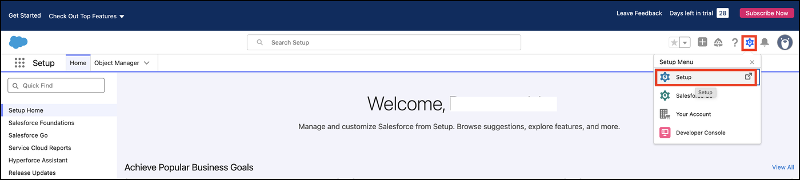
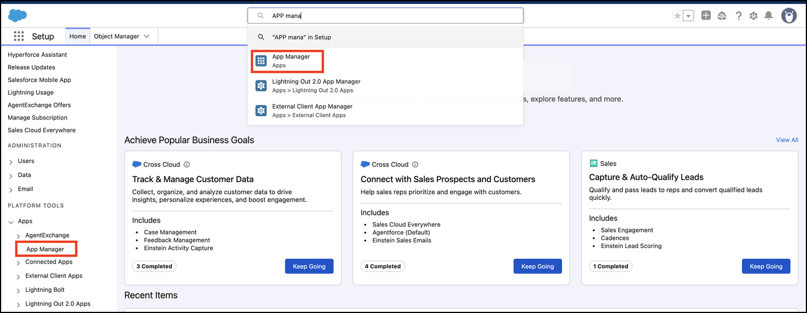
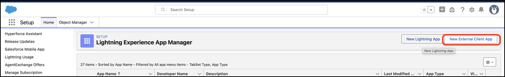
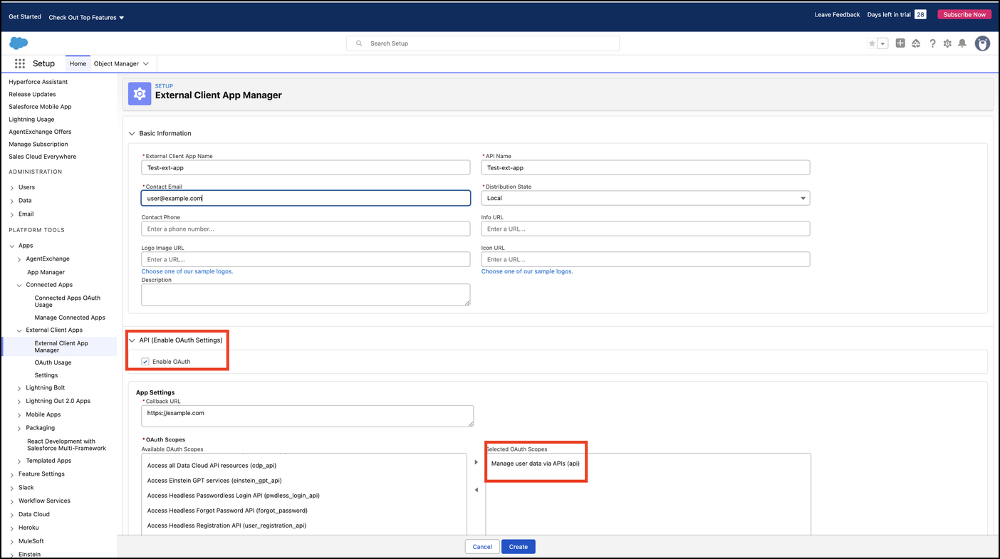
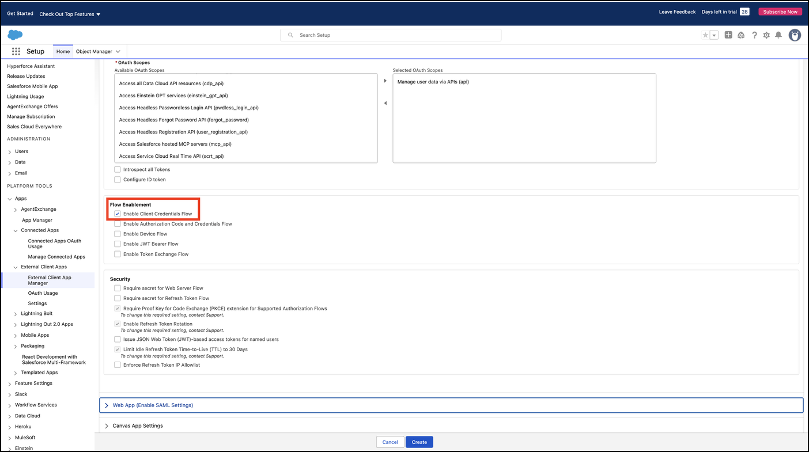
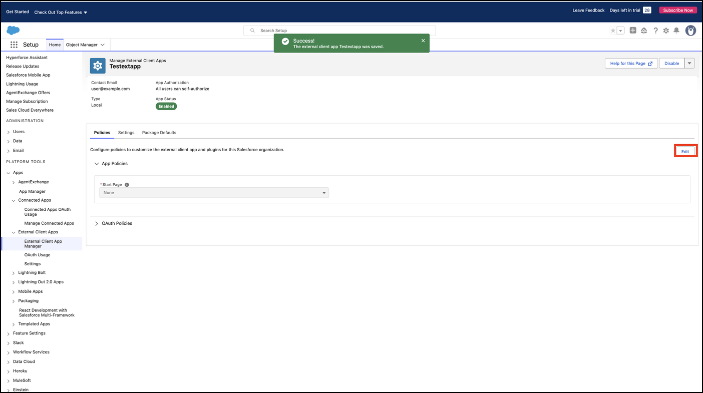
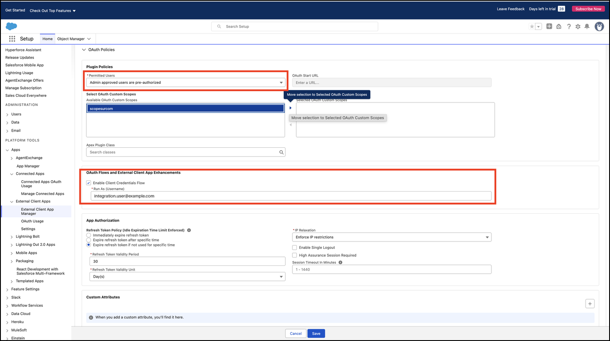
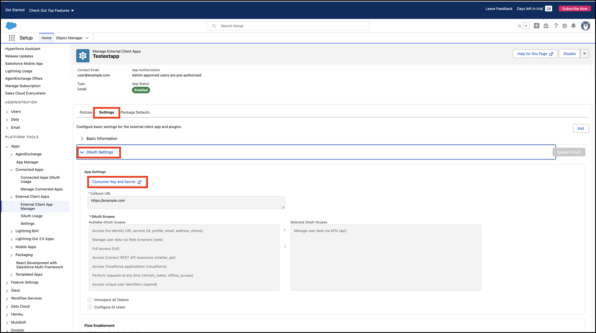
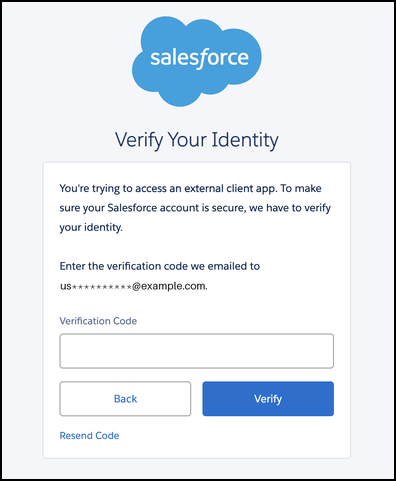

# __Description__

  Imports Salesforce users, roles, groups, contacts, accounts, assets, and support cases into Surface Command.

# __Overview__

  Salesforce is a cloud-based customer relationship management (CRM) platform used for sales, service, marketing, and enterprise application development.

  This connector imports identity, organizational hierarchy, access group, support case, and asset inventory data from Salesforce into Rapid7 Surface Command, synchronizing the Salesforce Case, Contact, User, UserRole, Group, Organization, Account, and Asset records to enable security posture monitoring, access governance, and cross-platform correlation.

# __Documentation__

  ## __Setup__

  This connector authenticates with the OAuth 2.0 Client Credentials Flow using an External Client App (or a legacy Connected App) in your Salesforce org.

  The `Base URL` is the My Domain URL of your Salesforce org, found under **Setup** > **Company Settings** > **My Domain**.

  By default, only active Salesforce Users are imported. Disable `Only Active Users?` to also import deactivated Users.

  Only Cases whose Status is listed in `Case States` (a comma-separated list, e.g. `New, Working, Escalated`) are imported. Include any custom statuses your org uses; find them under **Setup** > **Object Manager** > **Case** > **Fields & Relationships** > **Status**. Leave `Case States` empty to skip Cases.

  ### To create an External Client App and get the `Client ID` and `Client Secret`

  1. Sign in to Salesforce as an administrator and go to **Setup**.
     
  2. In the Quick Find box, search for **App Manager**, open **App Manager**, then click **New External Client App**. In orgs that still use legacy Connected Apps, click **New Connected App** instead.
     
     
  3. Provide an **External Client App Name** and **Contact Email**, and leave **Distribution State** as `Local`.
  4. Under **API (Enable OAuth Settings)**, select **Enable OAuth**, then:
     - Enter a **Callback URL**. It is required by the form but not used by the Client Credentials Flow, so any valid URL (for example `https://localhost`) works.
     - Add the `Manage user data via APIs (api)` **OAuth Scope**. It is required to run SOQL queries against Case, Contact, User, UserRole, Group, Organization, Account, and Asset.
     
  5. Under **Flow Enablement**, enable **Client Credentials Flow**, then create the app.
     
  6. Edit the app's policies (**Policies** tab > **Edit**):
     
     - Set **Permitted Users** to `Admin approved users are pre-authorized` (required for the Client Credentials Flow).
     - Under **Client Credentials Flow**, enter the username of a dedicated **Run As** user, you can find the username under **Setup** > **Users**. The connector reads Salesforce as this user, so it only imports the records this user can see. See **Run As user permissions** below.
     - If your org restricts login IP ranges, the token request is rejected unless it comes from an allowed IP address. Either allowlist the Surface Command IP ranges for your region (see **Allowlist the Surface Command IP addresses** below), or set **IP Relaxation** to `Relax IP restrictions`.
     
  7. Go to the **Settings** tab, expand **OAuth Settings** and click **Consumer Key and Secret**. Salesforce emails you a one-time verification code; enter it to reveal the keys.
     
     
  8. Copy the **Consumer Key** and **Consumer Secret** into the connector's `Client ID` and `Client Secret` settings.

  ### Allowlist the Surface Command IP addresses

  > Note If your Salesforce org only allows sign-ins from trusted IP addresses, Salesforce rejects the connector's requests unless they come from an allowed address. In that case, you must also allowlist the IP ranges Surface Command connects from. Find the IP ranges for your Surface Command region in [Allowlist Surface Command IPs](https://docs.rapid7.com/surface-command/allowlist-surface-command-ips/), then add each range in Salesforce.

  ### Run As user permissions

  We recommend a dedicated integration user with a read-only profile or permission set. It needs:

  * **API Enabled**, so it can call the Salesforce REST API.
  * **Read** access to the `Case`, `Contact`, `User`, `UserRole`, `Group`, `GroupMember`, `Organization`, `Account`, and `Asset` objects.
  * **View All Data**, or **View All** on the `Account`, `Contact`, `Case`, and `Asset` objects. Without it, Salesforce sharing rules only return the records this user owns or has been shared, and the import is silently incomplete.

  When you click **Test Connection**, the connector reports any object that returns no records, which usually means the Run As user can't read it.

  Refer to Salesforce's [Client Credentials Flow documentation](https://help.salesforce.com/s/articleView?id=xcloud.remoteaccess_oauth_client_credentials_flow.htm) and [Connected App setup guide](https://help.salesforce.com/s/articleView?id=sf.connected_app_create_api_integration.htm) for further details.
