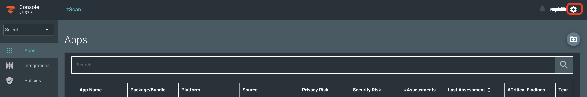
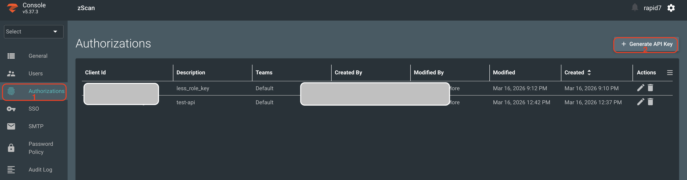
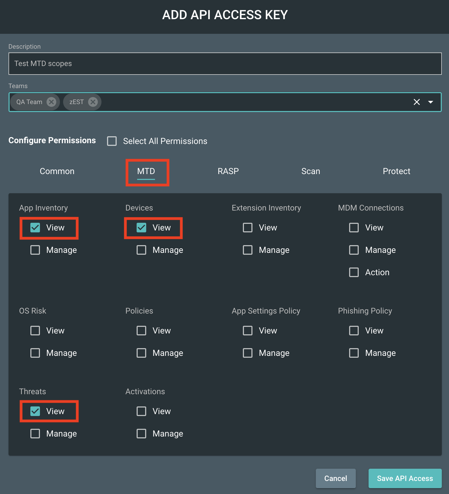

# __Description__

  Connector for Surface Command that imports mobile application and security finding data from Zimperium.

# __Overview__

  Zimperium secures both mobile devices and applications so they can safely and securely access data.

  This connector integrates mobile application inventory, threats and security findings data from the Zimperium API with the Rapid7 Platform, enabling visibility into mobile application security posture.

# __Documentation__

  This connector requires `Base URL`, `Client ID`, and `Client Secret` credentials to connect to the Zimperium API.

  #### Generating API Credentials
  - Log in to your zConsole. You must have administrative access to generate these values and access these options.
  - On the right-hand sidebar, click on the Authorizations tab (located under the 'Users' section).
  
  - Click the **[+ Generate API Key]** button located at the top right of the **Authorizations** table.
  
  - **Description**: Enter a clear name for the key (e.g., API-Surcom-Key).
  - **Teams**: Select the appropriate team from the dropdown menu that this API key will belong to.
  - Under **Configure Permissions**, grant the permissions required for all connector API calls:
    - In the **Common** tab, provide **`Teams`** View permission so the connector can retrieve team data (optional; see **Teams** below).
    - In the **MTD** tab, provide **`App Inventory`**, **`Devices`**, and **`Threats`** View permission so the connector can retrieve device, installed application, and threat data.
      
  - Click **Save API Access** to generate the credentials.
  - Copy the **Client ID** and **Client Secret** immediately — the secret is only shown once and cannot be retrieved later. Store these credentials securely (e.g., in a password manager).
  
  For more information, see the [Zimperium documentation](https://zc202.zimperium.com/console-docs/mtd-docs/api/getting_started.html).

  #### Point in Time Search

  By default, the connector imports at most 10,000 apps, and 10,000 threats for each selected severity, because Zimperium's standard APIs return at most 10,000 records. If your tenant has more than 10,000 apps, the connector imports only the apps installed on at least one device, starting with those installed on the most devices; apps installed on no device are skipped. Records beyond the limit are skipped and a warning is written to the import log.

  To import all records, enable the `Use Point in Time Search?` setting. It applies to apps, devices and threats; device CVEs are always imported with the standard APIs. Because CVEs and threats are imported together, the CVE and threat import also fails if Point in Time Search is not available for threats. This requires the **Enable Large Dataset Retrievals** option on your Zimperium account, which only Zimperium Support can turn on. If the setting is enabled but the account does not have this option, the connection test and the imports fail with a message saying that Point in Time Search is not enabled for this Zimperium account. To fix this, ask Zimperium Support to turn on the option, or turn off the `Use Point in Time Search?` setting.

  #### Threat Settings

  - `Threat Severity Threshold`: The minimum severity of threats to import. `High` corresponds to the Zimperium **Elevated** severity.
  - `Threat Lookback Day(s)`: The number of days to look back for threats when importing.

  #### Teams

  The **Teams** View permission is optional. Without it, the connector skips teams and still imports apps, devices, CVEs and threats.
